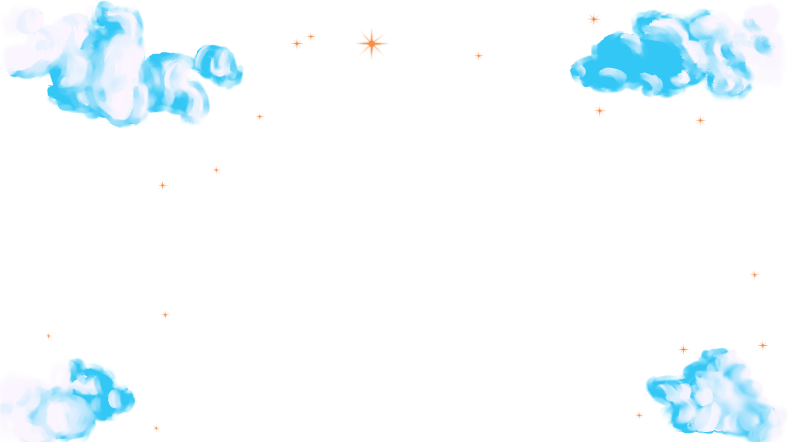

# Project Atlas

<p align="center">
  
</p>

**Project Atlas** is a browser-based editor for creating and exploring fictional maps. Draw places and paths, add labels and images, organize map elements into layers, and save your work through the maps API.

## Artwork

The Atlas logos, Atla character artwork, tools, cloud illustrations, etc... were drawn by the project author.

<p align="center">
  
  &nbsp;&nbsp;&nbsp;
  
  &nbsp;&nbsp;&nbsp;
  
</p>

## Features

- Create and edit fictional maps on a fixed-coordinate canvas that adapts to the viewport.
- Draw with a configurable brush and erase strokes.
- Add pins with location details, text labels, and images from URLs.
- Map owners can remove pins with a right-click; the deletion can be undone and is persisted when the map is saved. Non-owners can view pin details without editing them.
- Organize map content into layers, toggle layer visibility, and undo recent edits.
- Zoom and pan around the canvas.
- Browse maps, like them, and delete maps you own.
- Save new maps and update existing maps using the configured API. A preview is generated automatically from the map canvas.
- Sign up and sign in with an email and password. Sign-up requires a matching password confirmation.

## Future improvements and ideas

The following ideas are possible future directions for Project Atlas and are not
currently implemented.

### Editing experience

- [ ] Add move, resize, rotate, and transform controls for pins and labels.
- [ ] Support selecting multiple map elements and editing or deleting them as a group.
- [ ] Add copy, paste, and duplicate actions.
- [ ] Improve the undo and redo system so it covers every editor action.
- [ ] Add shape tools, dashed and custom brush styles, brush pressure, and a fill tool.
- [ ] Add snapping, rulers, and guides for more precise map layouts.
- [ ] Add keyboard shortcuts for saving, creating layers, toggling visibility, and zooming.
- [ ] Provide context menus for renaming layers and editing or duplicating elements.
- [ ] Add an autosave draft and explicit recovery for interrupted editing sessions.

### Map authoring

- [ ] Support custom map backgrounds, reusable assets, and externally hosted map tiles.
- [ ] Add worldbuilding fields such as regions, factions, characters, points of interest,
  relationships, and timeline events.
- [ ] Add searchable map legends and filters for pins and locations.
- [ ] Allow regions and routes to have custom colors, icons, descriptions, and categories.
- [ ] Support collaborative editing with presence, permissions, comments, and live cursors.
- [ ] Let users create map collections or campaigns containing multiple related maps.
- [ ] Add templates for fantasy kingdoms, settlements, dungeons, and travel routes.
- [ ] Support version history and named snapshots for maps.
- [ ] Export maps as PNG, SVG, PDF, or JSON and import Project Atlas JSON maps.
- [ ] Generate shareable public links with optional password protection or expiration.

### Discovery and community

- [ ] Add sorting and filtering for featured, newest, most reacted-to, and recently updated maps.
- [ ] Add tags, map categories, full-text search, and user profiles.
- [ ] Allow public or private sharing and configurable collaborator permissions.
- [ ] Add map collections, favorites, and following between creators.
- [ ] Add customizable emoji reactions to maps and comments, replacing the generic like button.
- [ ] Add moderation tools for inappropriate public content and image URLs.
- [ ] Improve empty, loading, error, offline, and unauthorized states.
- [ ] Add a personalized loading animation with clear progress or status feedback.

### Account and security

- [ ] Add password reset, email verification, and account-management screens.
- [ ] Improve session handling with refresh tokens and automatic session expiry feedback.
- [ ] Add social sign-in and optional multi-factor authentication.
- [ ] Add image upload validation, size limits, and server-side scanning.

### Quality and technical improvements

- [ ] Add a dark mode with a theme toggle and a saved user preference.
- [ ] Introduce a typed data model or migrate to TypeScript.
- [ ] Add unit and integration tests for the canvas, layers, tools, authentication, and API.
- [ ] Add end-to-end tests for creating, saving, loading, reacting to, and deleting maps.
- [ ] Configure CI to run linting, tests, and production builds on pull requests.
- [ ] Split large components and hooks further and add an API/client error abstraction.
- [ ] Replace fixed canvas coordinates with configurable canvas sizes and responsive defaults.
- [ ] Optimize large maps through virtualization, object caching, and staged preview rendering.
- [ ] Cache API responses, add request cancellation, and improve optimistic updates.
- [ ] Improve accessibility with focus management, screen-reader labels, and keyboard use.
- [ ] Audit mobile and tablet interactions, touch gestures, and small-screen layouts.
- [ ] Add deployment configuration and environment-specific API documentation.

### Keyboard shortcuts

| Key                | Action                  |
| ------------------ | ----------------------- |
| `P`                | Select the pin tool     |
| `B`                | Select the brush tool   |
| `E`                | Select the eraser       |
| `T`                | Select the text tool    |
| `I`                | Select the image tool   |
| `L`                | Toggle the layers panel |
| `Ctrl+Z` / `Cmd+Z` | Undo the last change    |

## Tech stack

- React
- Vite
- React Router
- React Konva / Konva

## Getting started

### Requirements

- Node.js and npm
- A maps API compatible with the endpoints below

### Install and run

```bash
npm install
```

Set the API base URL in a local environment file such as `.env.local`:

```env
VITE_API_URL=http://localhost:3000
```

Then start the development server:

```bash
npm run dev
```

Vite prints the local URL in the terminal when the server is ready.

The API is configured separately from this frontend repository. Start a
compatible API at the URL set in `VITE_API_URL` before using sign-up, login, or
map features. Creating and editing maps requires an authenticated user; the app
does not create a temporary or anonymous user.

## API configuration

The frontend reads `VITE_API_URL` and expects the API to provide:

| Method           | Endpoint             | Purpose                 |
| ---------------- | -------------------- | ----------------------- |
| `POST`           | `/signup`            | Create an account       |
| `POST`           | `/signin`            | Sign in and get a token |
| `GET`            | `/users/me`          | Get the current user    |
| `GET`            | `/maps`              | List maps               |
| `GET`            | `/maps/:mapId`       | Load a map              |
| `POST`           | `/maps`              | Save a map              |
| `PATCH`          | `/maps/:mapId`       | Update a map            |
| `DELETE`         | `/maps/:mapId`       | Delete a map            |
| `PUT` / `DELETE` | `/maps/:mapId/likes` | Like or unlike a map    |

The API exchanges JSON and returns map records directly (a JSON array for
`GET /maps`, one object for map detail/create/update). A saved map is submitted
as `{ "name": "...", "image": "...", "map": { "layers": [] } }`. `image` may
be an HTTP(S) URL or the JPEG data URL generated from the canvas. Layers preserve
their pins, drawings, labels, images, and visibility settings. The Maps page
shows maps returned by the API. Protected requests use a bearer token returned
by `/signin`. The sign-up form checks that the password confirmation matches
before submitting credentials.

## Available scripts

```bash
npm run dev      # Start the development server
npm run build    # Create a production build
npm run preview  # Preview the production build locally
npm run lint     # Run ESLint
```

```
Project_Atlas_Frontend
├─ eslint.config.js
├─ index.html
├─ package-lock.json
├─ package.json
├─ public
│  ├─ favicon.svg
│  └─ icons.svg
├─ README.md
├─ src
│  ├─ components
│  │  ├─ About
│  │  │  ├─ about.css
│  │  │  └─ About.jsx
│  │  ├─ App.css
│  │  ├─ App.jsx
│  │  ├─ arrow.css
│  │  ├─ Footer
│  │  │  ├─ footer.css
│  │  │  └─ Footer.jsx
│  │  ├─ Header
│  │  │  ├─ header.css
│  │  │  └─ Header.jsx
│  │  ├─ Main
│  │  │  ├─ Components
│  │  │  │  └─ MapCanvas
│  │  │  │     ├─ components
│  │  │  │     │  └─ mapcanvas
│  │  │  │     │     ├─ CanvasControls.jsx
│  │  │  │     │     ├─ createSaveMapHandler.jsx
│  │  │  │     │     ├─ LayerPanel.jsx
│  │  │  │     │     ├─ mapCanvasToolStyles.js
│  │  │  │     │     ├─ MapLayerContent.jsx
│  │  │  │     │     ├─ MapStage.jsx
│  │  │  │     │     ├─ PinPreview.jsx
│  │  │  │     │     └─ TextEditor.jsx
│  │  │  │     ├─ hooks
│  │  │  │     │  ├─ useMapCanvas.js
│  │  │  │     │  ├─ useMapLayers.js
│  │  │  │     │  ├─ useMapTools.jsx
│  │  │  │     │  ├─ useMapViewport.js
│  │  │  │     │  └─ useStageDisplay.js
│  │  │  │     ├─ mapcanvas.css
│  │  │  │     └─ mapcanvas.jsx
│  │  │  ├─ main.css
│  │  │  └─ Main.jsx
│  │  ├─ MapDetailRoute
│  │  │  └─ MapDetailRoute.jsx
│  │  ├─ Maps
│  │  │  ├─ Map
│  │  │  │  ├─ map.css
│  │  │  │  └─ Map.jsx
│  │  │  ├─ maps.css
│  │  │  └─ Maps.jsx
│  │  ├─ Navigation
│  │  │  ├─ navigation.css
│  │  │  └─ Navigation.jsx
│  │  ├─ pages
│  │  │  ├─ auth-pages.css
│  │  │  ├─ Login.jsx
│  │  │  └─ Register.jsx
│  │  ├─ Popup
│  │  │  ├─ components
│  │  │  │  ├─ AddImage
│  │  │  │  │  └─ AddImage.jsx
│  │  │  │  ├─ InfoToolTip
│  │  │  │  │  ├─ components
│  │  │  │  │  │  ├─ IsAuthorized.jsx
│  │  │  │  │  │  └─ IsNotAuthorized.jsx
│  │  │  │  │  └─ InfoToolTip.jsx
│  │  │  │  ├─ NewMap
│  │  │  │  │  └─ NewMap.jsx
│  │  │  │  ├─ PinPopup
│  │  │  │  │  ├─ PinPopup.jsx
│  │  │  │  │  └─ PinReadOnlyPopup.jsx
│  │  │  │  ├─ PopupWithConfirmation
│  │  │  │  │  └─ PopupWithConfirmation.jsx
│  │  │  │  └─ SaveMap
│  │  │  │     └─ SaveMap.jsx
│  │  │  ├─ popup.css
│  │  │  └─ Popup.jsx
│  │  ├─ Preloader
│  │  │  ├─ preloader.css
│  │  │  └─ Preloader.jsx
│  │  ├─ ProtectedRoute
│  │  │  └─ ProtectedRoute.jsx
│  │  └─ Sidebar
│  │     ├─ sidebar.css
│  │     └─ Sidebar.jsx
│  ├─ contexts
│  │  └─ CurrentUserContext.js
│  ├─ images
│  │  ├─ arrow.svg
│  │  ├─ atla-flying.png
│  │  ├─ atla-head.svg
│  │  ├─ atla-icon.svg
│  │  ├─ atla-logo.png
│  │  ├─ close.svg
│  │  ├─ clouds.png
│  │  ├─ clouds2.png
│  │  ├─ clouds2.png~
│  │  ├─ delete-icon.svg
│  │  ├─ edit.svg
│  │  ├─ eraser.svg
│  │  ├─ eye.svg
│  │  ├─ github-icon.svg
│  │  ├─ image.svg
│  │  ├─ like-active.svg
│  │  ├─ like-inactive.svg
│  │  ├─ linkedin-icon.svg
│  │  ├─ move.svg
│  │  ├─ pencil.svg
│  │  ├─ pin.svg
│  │  ├─ quill.png
│  │  ├─ sign-background.png
│  │  ├─ sign-background.png~
│  │  ├─ zoom-less.svg
│  │  └─ zoom-plus.svg
│  ├─ index.css
│  ├─ main.jsx
│  ├─ utils
│  │  ├─ api.js
│  │  ├─ imageUrl.js
│  │  ├─ mapCanvasConfig.js
│  │  └─ token.js
│  ├─ variable.css
│  └─ vendor
│     ├─ fonts
│     │  ├─ Inter-Black.woff2
│     │  ├─ Inter-Medium.woff2
│     │  ├─ Inter-Regular.woff2
│     │  └─ PermanentMarker-Regular.ttf
│     ├─ fonts.css
│     └─ normalize.css
└─ vite.config.js

```
