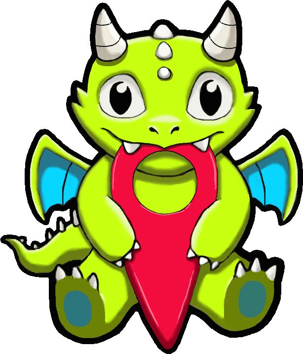
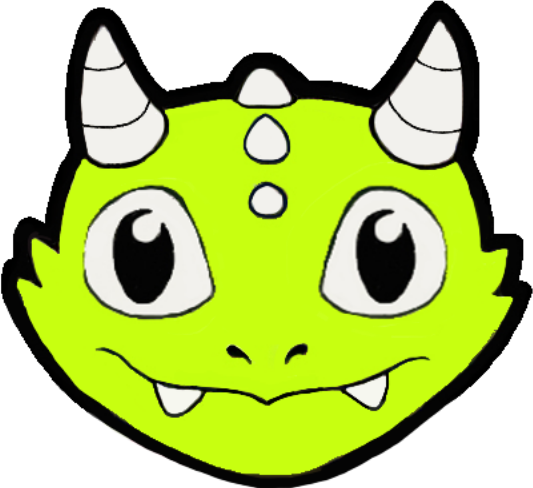
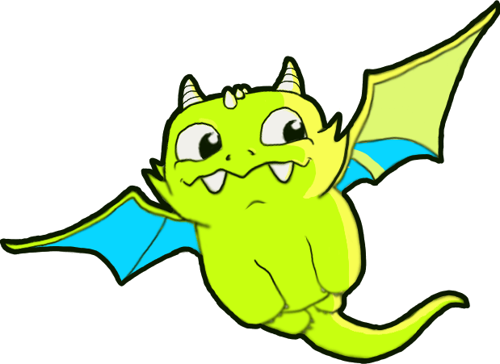
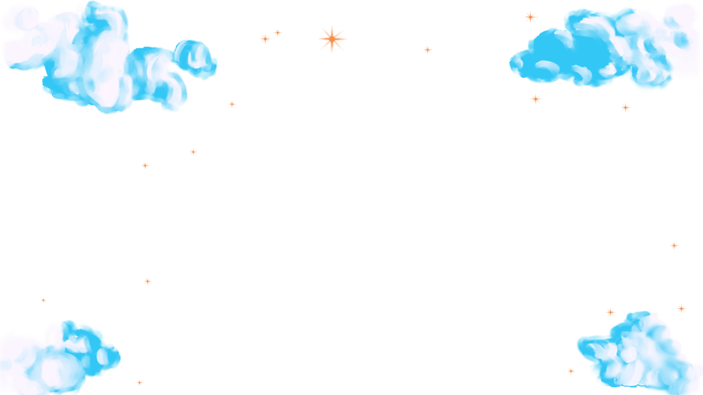

# Project Atlas

<p align="center">
  
</p>

**Project Atlas** is a browser-based editor for creating and exploring fictional maps. Draw places and paths, add labels and images, organize map elements into layers, and save your work through the maps API.

## Artwork

The Atlas logos, Atlas character artwork, tools, cloud illustrations, etc... were drawn by the project author.

<p align="center">
  
  &nbsp;&nbsp;&nbsp;
  
  &nbsp;&nbsp;&nbsp;
  
</p>

## Features

- Create and edit fictional maps on a fixed-coordinate canvas that adapts to the viewport.
- Draw with a configurable brush and erase strokes.
- Add pins with location details, text labels, and images from URLs.
- Organize map content into layers, toggle layer visibility, and undo recent edits.
- Zoom and pan around the canvas.
- Browse maps, like them, and delete maps you own.
- Save new maps and update existing maps using the configured API. A preview is generated automatically from the map canvas.

### Keyboard shortcuts

| Key                | Action                  |
| ------------------ | ----------------------- |
| `P`                | Select the pin tool     |
| `B`                | Select the brush tool   |
| `E`                | Select the eraser       |
| `T`                | Select the text tool    |
| `I`                | Select the image tool   |
| `L`                | Toggle the layers panel |
| `Ctrl+Z` / `Cmd+Z` | Undo the last change    |

## Tech stack

- React
- Vite
- React Router
- React Konva / Konva

## Getting started

### Requirements

- Node.js and npm
- A maps API compatible with the endpoints below

### Install and run

```bash
npm install
```

Set the API base URL in a local environment file such as `.env.local`:

```env
VITE_API_URL=http://localhost:3000
```

Then start the development server:

```bash
npm run dev
```

Vite prints the local URL in the terminal when the server is ready.

### Run the backend

The Express backend lives in `backend`. Configure `backend/.env` with a MongoDB
connection string before starting it:

```env
MONGO_URI=mongodb://127.0.0.1:27017/project-atlas
PORT=3000
```

Then install and start the backend from that directory:

```bash
cd backend
npm install
npm run dev
```

The frontend includes sign-up and login flows and requires an authenticated
user for map actions. It does not create a temporary or anonymous user.

## API configuration

The frontend reads `VITE_API_URL` and expects the API to provide:

| Method           | Endpoint             | Purpose              |
| ---------------- | -------------------- | -------------------- |
| `GET`            | `/maps`              | List maps            |
| `GET`            | `/maps/:mapId`       | Load a map           |
| `POST`           | `/maps`              | Save a map           |
| `PATCH`          | `/maps/:mapId`       | Update a map         |
| `DELETE`         | `/maps/:mapId`       | Delete a map         |
| `PUT` / `DELETE` | `/maps/:mapId/likes` | Like or unlike a map |

The API exchanges JSON and returns map records directly (a JSON array for
`GET /maps`, one object for map detail/create/update). A saved map is submitted
as `{ "name": "...", "image": "...", "map": { "layers": [] } }`. `image` may
be an HTTP(S) URL or the JPEG data URL generated from the canvas. Layers preserve
their pins, drawings, labels, images, and visibility settings. The Maps page
shows maps returned by the API.

## Available scripts

```bash
npm run dev      # Start the development server
npm run build    # Create a production build
npm run preview  # Preview the production build locally
npm run lint     # Run ESLint
```

```
Project_Atlas_Frontend
├─ eslint.config.js
├─ index.html
├─ package-lock.json
├─ package.json
├─ public
│  ├─ favicon.svg
│  └─ icons.svg
├─ README.md
├─ src
│  ├─ components
│  │  ├─ About
│  │  │  ├─ about.css
│  │  │  └─ About.jsx
│  │  ├─ App.css
│  │  ├─ App.jsx
│  │  ├─ arrow.css
│  │  ├─ Footer
│  │  │  ├─ footer.css
│  │  │  └─ Footer.jsx
│  │  ├─ Header
│  │  │  ├─ header.css
│  │  │  └─ Header.jsx
│  │  ├─ Main
│  │  │  ├─ Components
│  │  │  │  └─ MapCanvas
│  │  │  │     ├─ components
│  │  │  │     │  └─ mapcanvas
│  │  │  │     │     ├─ CanvasControls.jsx
│  │  │  │     │     ├─ LayerPanel.jsx
│  │  │  │     │     ├─ MapStage.jsx
│  │  │  │     │     ├─ PinPreview.jsx
│  │  │  │     │     └─ TextEditor.jsx
│  │  │  │     ├─ hooks
│  │  │  │     │  ├─ useMapCanvas.js
│  │  │  │     │  ├─ useMapLayers.js
│  │  │  │     │  ├─ useMapTools.jsx
│  │  │  │     │  └─ useMapViewport.js
│  │  │  │     ├─ mapcanvas.css
│  │  │  │     └─ mapcanvas.jsx
│  │  │  ├─ main.css
│  │  │  └─ Main.jsx
│  │  ├─ Maps
│  │  │  ├─ Map
│  │  │  │  ├─ map.css
│  │  │  │  └─ Map.jsx
│  │  │  ├─ maps.css
│  │  │  └─ Maps.jsx
│  │  ├─ Navigation
│  │  │  ├─ navigation.css
│  │  │  └─ Navigation.jsx
│  │  ├─ Popup
│  │  │  ├─ components
│  │  │  │  ├─ AddImage
│  │  │  │  │  └─ AddImage.jsx
│  │  │  │  ├─ NewMap
│  │  │  │  │  └─ NewMap.jsx
│  │  │  │  ├─ PinPopup
│  │  │  │  │  └─ PinPopup.jsx
│  │  │  │  ├─ PopupWithConfirmation
│  │  │  │  │  └─ PopupWithConfirmation.jsx
│  │  │  │  └─ SaveMap
│  │  │  │     └─ SaveMap.jsx
│  │  │  ├─ popup.css
│  │  │  └─ Popup.jsx
│  │  ├─ Preloader
│  │  │  ├─ preloader.css
│  │  │  └─ Preloader.jsx
│  │  └─ Sidebar
│  │     ├─ sidebar.css
│  │     └─ Sidebar.jsx
│  ├─ contexts
│  │  └─ CurrentUserContext.js
│  ├─ images
│  │  ├─ arrow.svg
│  │  ├─ atla-flying.png
│  │  ├─ atla-head.svg
│  │  ├─ atla-icon.svg
│  │  ├─ atla-logo.png
│  │  ├─ close.svg
│  │  ├─ clouds.png
│  │  ├─ clouds2.png
│  │  ├─ clouds2.png~
│  │  ├─ delete-icon.svg
│  │  ├─ edit.svg
│  │  ├─ eraser.svg
│  │  ├─ github-icon.svg
│  │  ├─ image.svg
│  │  ├─ like-active.svg
│  │  ├─ like-inactive.svg
│  │  ├─ linkedin-icon.svg
│  │  ├─ move.svg
│  │  ├─ pencil.svg
│  │  ├─ pin.svg
│  │  ├─ quill.png
│  │  ├─ zoom-less.svg
│  │  └─ zoom-plus.svg
│  ├─ index.css
│  ├─ main.jsx
│  ├─ utils
│  │  ├─ api.js
│  │  ├─ defaultMap.js
│  │  ├─ imageUrl.js
│  │  └─ mapCanvasConfig.js
│  ├─ variable.css
│  └─ vendor
│     ├─ fonts
│     │  ├─ Inter-Black.woff2
│     │  ├─ Inter-Medium.woff2
│     │  ├─ Inter-Regular.woff2
│     │  └─ PermanentMarker-Regular.ttf
│     ├─ fonts.css
│     └─ normalize.css
└─ vite.config.js

```
